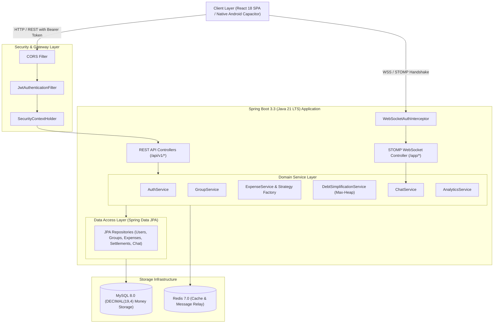

# SplitWise — Full-Stack & Native Android Platform

[](https://openjdk.org/)
[](https://spring.io/projects/spring-boot)
[](https://react.dev/)
[](https://capacitorjs.com/)
[](https://tailwindcss.com/)
[](https://www.mysql.com/)
[](#-running-algorithm-unit-tests)

A production-grade, enterprise-ready **Splitwise Clone** built with **Java 21 LTS, Spring Boot 3.3, Spring Security 6 + JWT, WebSocket (STOMP), MySQL 8, Redis 7, React 18, Tailwind CSS**, and a **Native Android Application** powered by **Capacitor**.

---

## 📚 Complete Project Documentation Suite

To help you understand, build, and present this project in technical interviews, detailed master guides are available:

| Document | Purpose & Key Highlights | Link |
|---|---|---|
| **High-Level Overview** | Plain-English summary of the entire project with simple Mermaid block diagrams | [overview.md](overview.md) |
| **Backend Master Guide** | Deep-dive into Java 21, Strategy Pattern, Min-Cash-Flow graph algorithm, Anti-IDOR, and 12 interview Q&As | [backend.md](backend.md) |
| **Frontend Master Guide** | Deep-dive into React 18, Zustand state, Axios 401 token refresh queue, STOMP hooks, and 12 interview Q&As | [frontend.md](frontend.md) |
| **Android Build Guide** | Capacitor native bridge, Android Studio workflow, hardware back button, and APK/AAB generation | [android.md](android.md) |

---

## 🌟 Key Features

### 1. Multi-Platform Support (Web & Native Android)
- **Web App**: Fast, responsive React 18 SPA built with Vite and Tailwind CSS.
- **Native Android App**: Powered by Capacitor (`com.shivam.splitwiseclone`) with native status bar theming, safe-area inset adaptation, hardware back-button interceptor, adaptive launcher icon, and Android virtual keyboard auto-resizing.
- **Mobile Bottom Navigation**: Thumb-friendly bottom navigation bar (`BottomNav.tsx`) with quick "Create Group" action button.

### 2. Dual-Currency Reactive Engine
- Automatically converts and displays real-time US Dollar equivalents ($\sim\$X.XX$) alongside Indian Rupee amounts (**₹**) with zero layout shifts.
- Context-aware international phone number prefixes: automatically sets `+91 ` for INR and `+1 ` for USD.
- Standardized, professional form placeholders (`username`, `group_name`, `expense_title`, `password`).

### 3. Dark & Light Mode Theme Engine
- Zero Flash of Unstyled Content (FOUC) theme switcher.
- Automatically detects OS color preference (`prefers-color-scheme`), persists choice to storage, and dynamically changes the native Android status bar styling.

### 4. Advanced Expense Splitting (Strategy Design Pattern)
- **Equal Split**: Even division with guaranteed penny remainder distribution ($100 / 3 \rightarrow \$33.34, \$33.33, \$33.33$).
- **Exact Split**: Explicit amounts per participant strictly validated against the total amount.
- **Percentage Split**: Precise percentage division with penny rounding reconciliation.
- **Share-Based Split**: Proportional ratio division with fair remainder allocation.
- **Multi-Payer Support**: Allows multiple members to co-fund an expense (e.g., Alice paid \$60, Bob paid \$40).

### 5. Min-Cash-Flow Debt Simplification Algorithm
- Accurate Net Balance calculation:
  $$\text{Net Balance} = (\text{Total Paid} - \text{Total Owed}) + (\text{Settlements Paid} - \text{Settlements Received})$$
- Greedy Dual Max-Heap algorithm reducing up to $O(N^2)$ pairwise debts down to at most $N-1$ minimal cash transactions in $O(K \log K)$ time.
- One-click **"Settle Up"** recording direct cash or digital payments.

### 6. Real-Time Group Chat (WebSocket + STOMP)
- Bidirectional real-time group chat channel (`/topic/groups/{groupId}/chat`).
- Ephemeral live typing indicators (`"Alice is typing..."`) with 3-second auto-expiration timers.
- Double blue checkmark read receipts (`/topic/groups/{groupId}/read`).
- Receipt attachment and image uploads with file type sanitization.

### 7. Security & Anti-IDOR Authorization
- Stateless JWT access tokens (15-minute expiry) + secure refresh token rotation (7-day expiry).
- **Mobile Secure Storage**: Uses `@capacitor/preferences` (Android `SharedPreferences` in private sandbox storage) on mobile, preventing plain-text token exposure.
- **Mutex Axios Interceptor**: Eliminates 401 refresh token race conditions with an asynchronous request queue.
- Custom `GroupPermissionEvaluator` preventing Insecure Direct Object References (IDOR).
- Custom Spring `WebSocketAuthInterceptor` validating JWT tokens and group membership on STOMP `CONNECT`, `SUBSCRIBE`, and `SEND` frames.

---

## 🏗️ Architecture & Technology Stack



| Layer | Technologies |
|---|---|
| **Backend** | Java 21 LTS, Spring Boot 3.3.4, Spring Data JPA, Spring Security 6, Spring WebSocket (STOMP), Hibernate |
| **Frontend** | React 18.3, TypeScript 5.5, Vite 5.4, Tailwind CSS 3.4, Zustand 4.5, Axios, Lucide Icons |
| **Mobile** | Capacitor 8 (Android Platform, Preferences, App, Status-Bar, Splash-Screen, Keyboard) |
| **Database** | MySQL 8.0 (InnoDB) for production; H2 MySQL-dialect mode for zero-config local dev |
| **Cache & Relay** | Redis 7.0 for session cache and distributed WebSocket Pub/Sub |
| **Testing** | JUnit 5, AssertJ, Reflection Test Harness (19/19 Unit Tests Passing) |
| **Deployment** | Docker, Docker Compose, Nginx |

---

## 🚀 Getting Started

### 1. Prerequisites
- **Java**: JDK 21+ (`java -version`)
- **Node.js**: v18+ and npm 10+ (`node -v && npm -v`)
- **Android Studio** (optional, only for running/building the Android application)
- **Docker & Docker Compose** (optional, for full containerized deployment)

---

### 2. Running the Web Version Locally

#### Terminal 1: Start the Backend (Spring Boot)
```bash
cd backend
mvn clean test-compile
mvn spring-boot:run
```
*The backend starts at `http://localhost:8080` (pre-configured with zero-config in-memory database with MySQL dialect).*

#### Terminal 2: Start the Frontend (React + Vite)
```bash
cd frontend
npm install
npm run dev
```
*The frontend web app starts at `http://localhost:3000` with hot-module reloading and backend API proxying.*

---

### 3. Running the Android Application

#### Step 1: Build & Sync Web Assets to Android
```bash
cd frontend
npm run cap:build
```

#### Step 2: Open in Android Studio
```bash
npm run cap:open
```

#### Step 3: Run on Emulator or Physical Device
- Click **Run (▶)** in Android Studio, or run via CLI:
```bash
npx cap run android
```
*(When testing on the Android Emulator, the app connects to the backend at `http://10.0.2.2:8080/api/v1` automatically. For physical devices, see [android.md](android.md) to set your local Wi-Fi IP address).*

#### Step 4: Generate a Debug APK
```bash
cd frontend/android
./gradlew assembleDebug
```
*Output APK: `frontend/android/app/build/outputs/apk/debug/app-debug.apk`*

---

### 4. Running with Docker Compose (Production Environment)

To run the complete production stack (MySQL 8, Redis 7, Spring Boot Backend, and Nginx Frontend):
```bash
docker-compose up --build
```
- **Web App**: `http://localhost:3000`
- **Backend API**: `http://localhost:8080/api/v1`
- **MySQL**: `localhost:3306`
- **Redis**: `localhost:6379`

---

## 🧪 Running Algorithm Unit Tests

All 19 test scenarios verifying the splitting strategies and Min-Cash-Flow debt simplification algorithms can be executed directly:

```bash
cd backend
mvn test-compile
/Library/Java/JavaVirtualMachines/jdk-24.jdk/Contents/Home/bin/java -cp "target/classes:target/test-classes:$(find ~/.m2/repository -name '*.jar' | tr '\n' ':')" com.splitwise.TestRunner
```

**Test Execution Results:**
```
=================================================
RUNNING SPLITWISE PRODUCTION ALGORITHM TEST SUITE
=================================================

Testing Class: SplitStrategyTest
  [PASS] testPercentageSplitPennyReconciliation
  [PASS] testEqualSplitWithPennyRemainder
  [PASS] testEqualSplitExactDivision
  [PASS] testEqualSplitEmptyParticipants
  [PASS] testExactSplitValid
  [PASS] testExactSplitMismatch
  [PASS] testPercentageSplitValid
  [PASS] testPercentageSplitInvalidSum
  [PASS] testShareSplitValid

Testing Class: DebtSimplificationServiceTest
  [PASS] testEmptyBalances
  [PASS] testAllZeroBalances
  [PASS] testTwoMembersDirectDebt
  [PASS] testTransitiveSimplification
  [PASS] testCircularDebtCancelsOut
  [PASS] testOneCreditorTwoDebtors
  [PASS] testTwoCreditorsOneDebtor
  [PASS] testFourMembersMatching
  [PASS] testFiveMembersComplexTrip
  [PASS] testOddPenniesPrecision

=================================================
TOTAL TESTS: 19 | PASSED: 19 | FAILED: 0
=================================================
```

---

## 📁 Repository Directory Structure

```
split wise clone/
├── .gitignore                   # Excludes build outputs, OS files, and caches
├── README.md                    # Main Project Documentation
├── overview.md                  # High-Level Architecture Overview & Diagrams
├── backend.md                   # Complete Backend Technical Interview Master Guide
├── frontend.md                  # Complete Frontend Technical Interview Master Guide
├── android.md                   # Native Android Build & Deployment Guide
├── docker-compose.yml           # Full production container configuration
│
├── backend/                     # Spring Boot 3.3 (Java 21) Modular Monolith
│   ├── pom.xml                  # Maven dependencies & Lombok configuration
│   └── src/main/java/com/splitwise/
│       ├── config/              # Security, CORS, WebSocket, JPA Auditing
│       ├── security/            # JWT Token Provider, Interceptors, ACL
│       └── modules/             # Domain Contexts (auth, group, expense, settlement, chat)
│
└── frontend/                    # React 18 + Vite + Tailwind + Capacitor
    ├── capacitor.config.ts      # Native Capacitor Configuration
    ├── package.json             # NPM dependencies & scripts
    ├── vite.config.ts           # Vite configuration & dev proxy
    ├── src/
    │   ├── components/          # UI Primitives, Layout, Expenses, Chat
    │   ├── hooks/               # useGroupChat (STOMP WebSocket hook)
    │   ├── lib/                 # api.ts (Axios client) & storage.ts (Capacitor/Web storage)
    │   ├── pages/               # Dashboard, Groups, GroupDetail, Profile, Auth
    │   ├── store/               # Zustand authStore & themeStore
    │   └── utils/               # Currency formatting & dual-currency conversion
    └── android/                 # Native Android Studio Project (SplitWise)
```

---

## 🛡️ License

This project is built for educational, portfolio, and production reference purposes.
