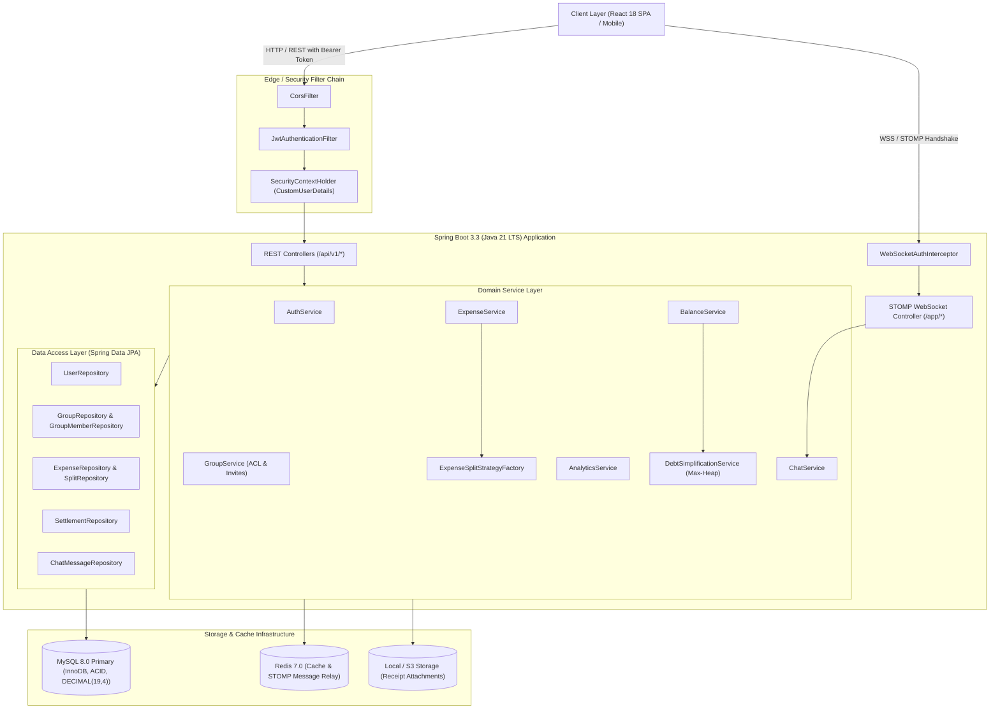
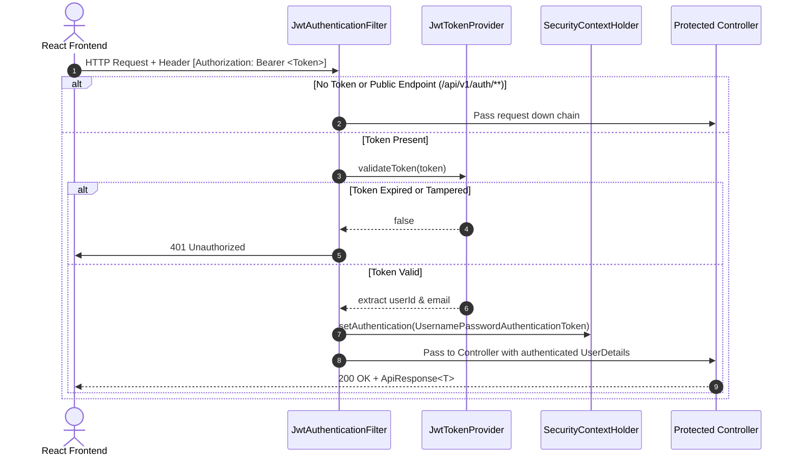
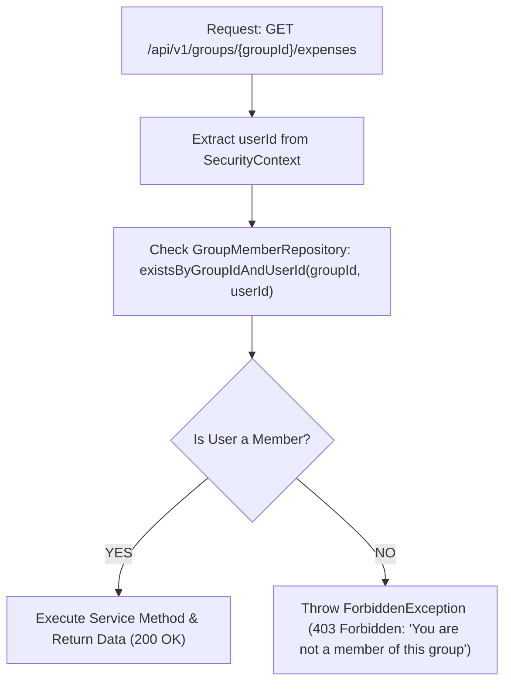
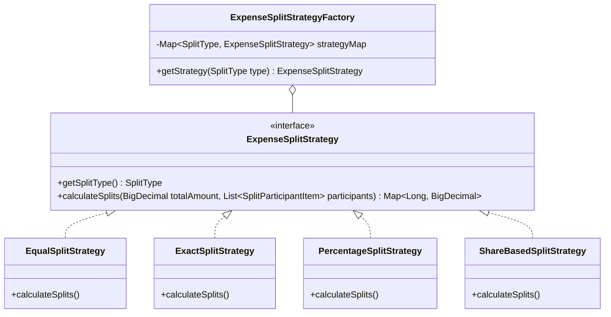
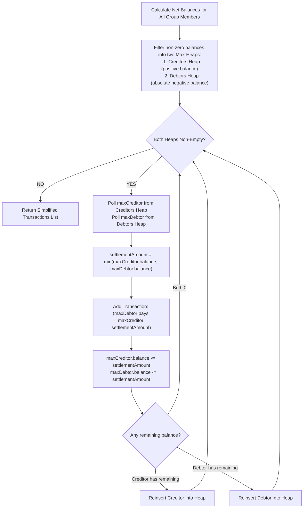
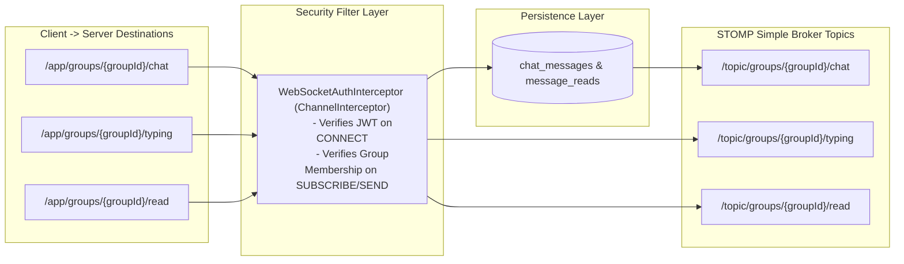
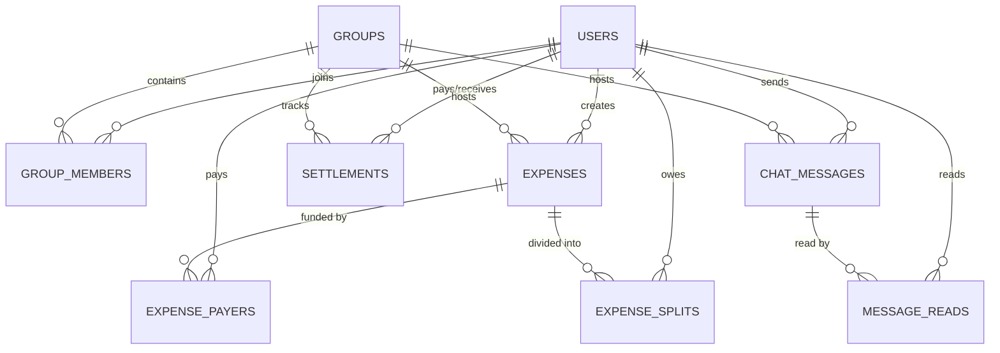

# Splitwise Backend — Complete Technical Interview Master Guide

> **Purpose of this Document**:  
> This guide breaks down the entire Splitwise backend codebase line-by-line, concept-by-concept, and algorithm-by-algorithm. It includes **visual block diagrams for every phase**, **design pattern explanations**, **database schemas**, and **exact answers you can speak in technical interviews**.

---

## Table of Contents
1. [The 30-Second Elevator Pitch (Start Your Interview Here)](#1-the-30-second-elevator-pitch)
2. [Complete System Architecture & Request Flow](#2-complete-system-architecture--request-flow)
3. [Backend Modular Monolith Package Structure](#3-backend-modular-monolith-package-structure)
4. [Phase 1: Security & Authentication (Spring Security 6 + JWT)](#4-phase-1-security--authentication-spring-security-6--jwt)
5. [Phase 2: Group Management & Membership Authorization (Anti-IDOR)](#5-phase-2-group-management--membership-authorization-anti-idor)
6. [Phase 3: Expense Engine & Strategy Pattern (The Core Math)](#6-phase-3-expense-engine--strategy-pattern-the-core-math)
7. [Phase 4: Balance Engine & Debt Simplification (Min-Cash-Flow Algorithm)](#7-phase-4-balance-engine--debt-simplification-min-cash-flow-algorithm)
8. [Phase 5: Real-Time Communication (WebSocket + STOMP Protocol)](#8-phase-5-real-time-communication-websocket--stomp-protocol)
9. [Phase 6: Database Schema, Concurrency & Data Consistency](#9-phase-6-database-schema-concurrency--data-consistency)
10. [Top 12 Tricky Interview Questions & Verbatim Model Answers](#10-top-12-tricky-interview-questions--verbatim-model-answers)

---

## 1. The 30-Second Elevator Pitch

When the interviewer asks: **"Tell me about this project and how you built the backend"**, say this:

> *"I designed and built a production-grade Splitwise clone using **Java 21 LTS** and **Spring Boot 3.3** structured as a domain-driven **Modular Monolith**.*  
> *The backend solves three core engineering challenges:*  
> 1. *Financial precision without floating-point errors using **BigDecimal** and the **Strategy Pattern** for Equal, Exact, Percentage, and Share-based splits with guaranteed penny distribution.*  
> 2. *A **Min-Cash-Flow graph debt simplification algorithm** using **Greedy Dual Max-Heaps**, reducing $O(N^2)$ pairwise debts down to at most $N-1$ minimal cash transactions in $O(K \log K)$ time.*  
> 3. *Real-time bidirectional communication using **WebSocket + STOMP** secured via a custom **ChannelInterceptor** that validates JWT tokens and prevents Insecure Direct Object References (IDOR) on group chat topics.*  
> *The persistence layer uses MySQL with JPA/Hibernate, Optimistic Locking (`@Version`) against race conditions, and Redis for distributed presence and caching."*

---

## 2. Complete System Architecture & Request Flow

### Architectural Block Diagram



### The End-to-End Request Lifecycle
1. **Client** issues an HTTP request with `Authorization: Bearer <JWT_ACCESS_TOKEN>`.
2. **`JwtAuthenticationFilter`** extracts the token, verifies the HMAC-SHA256 signature, parses user claims, loads `CustomUserDetails`, and populates `SecurityContextHolder`.
3. The **Controller** receives the validated DTO (`@Valid @RequestBody`).
4. The **Service** executes transactional business logic (`@Transactional`) ensuring atomic database operations.
5. In case of errors, the centralized **`GlobalExceptionHandler`** catches custom exceptions (`ResourceNotFoundException`, `BadRequestException`, `ForbiddenException`, `ConflictException`) and serializes a clean, standard `ApiResponse<T>`.

---

## 3. Backend Modular Monolith Package Structure

Why did we choose a **Modular Monolith** over microservices?
- **Interview Talking Point**: *Microservices introduce network latency, distributed transaction overhead (2-Phase Commit / Saga Pattern), and eventual consistency problems into financial records. A Modular Monolith keeps strict domain boundaries with zero network overhead and local ACID transactions, while remaining modular enough to extract into microservices if user volume exceeds 10 million DAU.*

```
backend/src/main/java/com/splitwise/
├── SplitwiseApplication.java             # Entry point
│
├── common/                              # Cross-cutting concerns
│   ├── audit/BaseAuditableEntity.java   # createdAt, updatedAt JPA Auditing
│   ├── exception/GlobalExceptionHandler.java # Standardized RFC-7807 error responses
│   ├── response/ApiResponse.java        # Standard { success, message, data, timestamp }
│   └── utils/MoneyUtils.java            # Banker's rounding, SCALE=2, sum, zero checks
│
├── config/                              # Spring configurations
│   ├── SecurityConfig.java              # SecurityFilterChain, PasswordEncoder, CORS
│   ├── WebSocketConfig.java             # STOMP broker registration & channel interceptors
│   └── JpaConfig.java                   # @EnableJpaAuditing
│
├── security/                            # Security infrastructure
│   ├── jwt/JwtTokenProvider.java        # HS256 token generation & validation
│   ├── jwt/JwtAuthenticationFilter.java # OncePerRequestFilter for Bearer token
│   ├── user/CustomUserDetails.java      # Spring Security UserDetails adapter
│   ├── user/CustomUserDetailsService.java # Database loader
│   ├── evaluator/GroupPermissionEvaluator.java # Custom SpEL ACL for @PreAuthorize
│   └── websocket/WebSocketAuthInterceptor.java # ChannelInterceptor for STOMP CONNECT/SUBSCRIBE
│
└── modules/                             # Domain Bounded Contexts
    ├── auth/                            # Register, Login, Refresh Token Rotation
    ├── user/                            # User profile & search
    ├── group/                           # Group lifecycle, roles, invite codes
    ├── expense/                         # Expense CRUD, payers, splits, Strategy Pattern
    ├── settlement/                      # Debt calculation & Min-Cash-Flow Heap algorithm
    ├── chat/                            # Real-time WebSocket messages, typing, read receipts
    ├── analytics/                       # Spending category & monthly trend aggregation
    └── media/                           # Receipt & image file uploads
```

---

## 4. Phase 1: Security & Authentication (Spring Security 6 + JWT)

### Architecture Block Diagram



### Key Technical Details to Explain in Interviews:
1. **Stateless JWT**:
   - Access token lifespan: **15 minutes** (short-lived for security).
   - Refresh token lifespan: **7 days** (long-lived for seamless UX).
   - Algorithm: **HMAC-SHA256 (`Jwts.SIG.HS256`)** using a 256-bit secret key.
2. **Password Security**:
   - Stored using **BCrypt with auto-generated salt** (strength 10).
   - Plaintext passwords are never logged, stored, or exposed.
   - User entity marks `passwordHash` with `@JsonIgnore` to prevent accidental JSON serialization in API responses.
3. **Refresh Token Rotation**:
   - When the client calls `POST /api/v1/auth/refresh`, the server issues a **new Access Token and a brand new Refresh Token**, invalidating the prior refresh token. If a stolen refresh token is re-used, the system detects a breach and invalidates the session.

---

## 5. Phase 2: Group Management & Membership Authorization (Anti-IDOR)

### What is IDOR and How Did We Solve It?
Insecure Direct Object Reference (IDOR) happens when an attacker changes `/api/v1/groups/10/expenses` to `/api/v1/groups/99/expenses` and accesses another group's private finances.

### Flowchart: Anti-IDOR Authorization Check



### Invite Code Mechanism
- Every group automatically receives an **8-character alphanumeric invite code** (e.g., `A7B8C9D0`) generated via `UUID.randomUUID().toString().substring(0, 8).toUpperCase()`.
- Users can join any group simply by providing the code via `POST /api/v1/groups/join/{inviteCode}` without needing a manual email invite.
- Group Admins can regenerate the code anytime via `POST /api/v1/groups/{groupId}/regenerate-invite`.

---

## 6. Phase 3: Expense Engine & Strategy Pattern (The Core Math)

### Strategy Pattern Class Diagram



### The 4 Splitting Algorithms Explained

#### 1. Equal Split (`EqualSplitStrategy.java`)
- **Formula**:
  $$\text{Base Share} = \lfloor \text{TotalAmount} / N \rfloor$$
  $$\text{Remainder} = \text{TotalAmount} - (\text{Base Share} \times N)$$
- **Penny Distribution Problem**:
  What if \$100.00 is split equally among 3 people?
  - Standard division: \$100.00 / 3 = \$33.3333...
  - If everyone owes \$33.33: $33.33 \times 3 = \$99.99$ (Where did the 1 cent go?).
- **Our Solution**:
  Convert remainder into integer pennies: `remainder.movePointRight(2).intValueExact() = 1 penny`.
  Add 1 cent (\$0.01) to the first `cents` members:
  - User 1: **\$33.34**
  - User 2: **\$33.33**
  - User 3: **\$33.33**
  - $\text{Total} = \$33.34 + \$33.33 + \$33.33 = \mathbf{\$100.00}$ (Invariant preserved!).

#### 2. Exact Split (`ExactSplitStrategy.java`)
- Each participant specifies their exact dollar amount.
- **Validation**:
  $$\sum \text{SplitAmounts} == \text{TotalAmount}$$
  If the sum differs even by \$0.01, the system rejects it with `BadRequestException`.

#### 3. Percentage Split (`PercentageSplitStrategy.java`)
- **Validation**: $\sum \text{Percentages} == 100.00\%$.
- Individual owed amount:
  $$\text{Owed} = \text{round}\left(\frac{\text{TotalAmount} \times \text{Percent}}{100}\right)$$
- If rounding causes a 1-cent discrepancy, our algorithm identifies the participant with the **highest percentage** and adjusts their share by $\pm \$0.01$ so the total matches exactly.

#### 4. Share-Based Split (`ShareBasedSplitStrategy.java`)
- Used when sharing bills based on ratios (e.g., Alice has 2 rooms, Bob has 1 room $\rightarrow$ 2:1 shares).
- **Formula**:
  $$\text{User Share} = \text{TotalAmount} \times \frac{\text{UserShares}}{\sum \text{Shares}}$$
- Fractional cents are sorted in descending order of remainder fraction, allocating remainder pennies to the highest fractional share.

#### Multi-Payer Data Model
In real life, multiple people can co-fund a bill (e.g., Alice paid \$60 and Bob paid \$40 on a \$100 bill).
Our system separates payers (`ExpensePayer`) from beneficiaries (`ExpenseSplit`):
$$\sum \text{ExpensePayers.amountPaid} = \text{Expense.totalAmount} = \sum \text{ExpenseSplits.owedAmount}$$

---

## 7. Phase 4: Balance Engine & Debt Simplification (Min-Cash-Flow Algorithm)

### Why Do We Need Debt Simplification?
In a group of $N$ members, if everyone pays for random items, there could be up to $\frac{N(N-1)}{2}$ separate debts. For 5 people, that is up to **10 transactions**!
Debt Simplification computes everyone's **Net Balance** and finds the minimal transactions required to bring every balance to \$0.00.
Maximum transactions will never exceed **$N - 1$** (at most 4 transactions for 5 people!).

### The Net Balance Formula
For every user $u$ in group $G$:
$$\text{Net Balance}(u) = (\text{Total Paid By } u - \text{Total Owed By } u) + (\text{Settlements Paid By } u - \text{Settlements Received By } u)$$
- **$\text{Net Balance} > 0$**: Creditor (should receive money).
- **$\text{Net Balance} < 0$**: Debtor (owes money).
- **Invariant**:
  $$\sum_{u \in G} \text{Net Balance}(u) = 0$$

### Algorithm Flowchart (Greedy Dual Max-Heap)



### Step-by-Step Numerical Example
Consider 3 roommates: **Alice**, **Bob**, and **Charlie**.
- **Net Balances**:
  - Alice: **+\$40.00** (Creditor)
  - Bob: **-\$10.00** (Debtor)
  - Charlie: **-\$30.00** (Debtor)
- **Step 1**:
  - Max Creditor = Alice (\$40.00).
  - Max Debtor = Charlie (\$30.00).
  - Minimum transfer amount = $\min(40, 30) = \mathbf{\$30.00}$.
  - **Transaction 1**: Charlie pays Alice **\$30.00**.
  - Remaining: Charlie = \$0.00, Alice = \$40 - \$30 = +\$10.00.
- **Step 2**:
  - Max Creditor = Alice (\$10.00).
  - Max Debtor = Bob (\$10.00).
  - Minimum transfer amount = $\min(10, 10) = \mathbf{\$10.00}$.
  - **Transaction 2**: Bob pays Alice **\$10.00**.
  - Remaining: Bob = \$0.00, Alice = \$0.00.
- **Result**:
  - **2 transactions** instead of 3 pairwise debts! All accounts settled!

### Complexity Analysis
- **Time Complexity**: $O(K \log K)$ where $K$ is the number of active group members with non-zero balances ($K \le N$). Polling and re-inserting into binary heaps takes $O(\log K)$ time, and each step eliminates at least one member.
- **Space Complexity**: $O(K)$ to maintain the two Priority Queues.

---

## 8. Phase 5: Real-Time Communication (WebSocket + STOMP Protocol)

### STOMP Architecture Diagram



### How We Secured WebSocket Connections (`WebSocketAuthInterceptor.java`)
Standard HTTP filters do NOT protect subsequent STOMP frames after the initial handshake.
We implemented Spring's `ChannelInterceptor`:
1. **CONNECT frame**:
   - Reads the `Authorization: Bearer <TOKEN>` header from native STOMP headers.
   - Validates JWT and attaches the authenticated `UsernamePasswordAuthenticationToken` to the WebSocket session.
2. **SUBSCRIBE & SEND frames**:
   - Inspects destination URI: `/topic/groups/{groupId}/*` or `/app/groups/{groupId}/*`.
   - Extracts `groupId` and queries `groupMemberRepository.existsByGroupIdAndUserId(groupId, currentUserId)`.
   - If an uninvited user tries to subscribe to a private group topic, an `AccessDeniedException` is thrown immediately, disconnecting the session.

---

## 9. Phase 6: Database Schema, Concurrency & Data Consistency

### Entity Relationship (ER) Diagram



### Concurrency & Data Consistency Protections
1. **Optimistic Locking via `@Version`**:
   - `Expense.java` and `Settlement.java` have a `@Version Long version` column.
   - If two roommates edit the same expense at the same second, Hibernate detects the version conflict and throws `OptimisticLockException`, preventing silent lost-update bugs.
2. **Monetary Precision**:
   - All financial amounts use `BigDecimal` in Java and `DECIMAL(19, 4)` in MySQL.
   - Never use `float` or `double` because binary floating point cannot accurately represent base-10 decimals like `0.10` or `0.01` (IEEE 754 precision error).
3. **Database Indexing**:
   - `idx_users_email` on `users(email)` for $O(1)$ login lookups.
   - Compound index `idx_expenses_group_date` on `expenses(group_id, expense_date)` for fast chronological group timeline queries.
   - Unique constraint `uk_group_user` on `group_members(group_id, user_id)` preventing duplicate membership.

---

## 10. Top 12 Tricky Interview Questions & Verbatim Model Answers

### Q1: Why did you use `BigDecimal` instead of `double` or `float`?
> **Answer**:  
> *"Binary floating-point types (`float` and `double`) implement IEEE 754 arithmetic where numbers like $0.1$ have infinite repeating binary representations, leading to round-off errors (e.g., $0.1 + 0.2 = 0.30000000000000004$). In financial applications like Splitwise, even a single-cent discrepancy corrupts balance reconciliation. `BigDecimal` provides arbitrary-precision signed decimal arithmetic with explicit rounding modes like `RoundingMode.HALF_EVEN` (Banker's rounding), ensuring that balances always sum to zero without money leaks."*

---

### Q2: How did you implement the Strategy Pattern for expense splitting?
> **Answer**:  
> *"I defined a common interface `ExpenseSplitStrategy` with a method `calculateSplits(BigDecimal totalAmount, List<SplitParticipantItem> participants)` returning `Map<Long, BigDecimal>`. I then implemented 4 concrete strategies: `EqualSplitStrategy`, `ExactSplitStrategy`, `PercentageSplitStrategy`, and `ShareBasedSplitStrategy`.*  
> *A Spring-managed `ExpenseSplitStrategyFactory` registers all strategies in an `EnumMap`. When an expense is created, the service requests the strategy based on the `SplitType` enum without needing fragile `if-else` or `switch` chains, adhering to the Open-Closed Principle (SOLID)."*

---

### Q3: What is the Min-Cash-Flow algorithm and how did you optimize it?
> **Answer**:  
> *"Debt simplification is modeled as a Min-Cash-Flow problem on a directed graph. Instead of $O(N^2)$ brute-force comparisons, I implemented a greedy algorithm using two Max-Heaps (`PriorityQueue`): one for net creditors (sorted descending by positive balance) and one for net debtors (sorted descending by absolute debt).*  
> *In each iteration, we poll the largest creditor and largest debtor, transfer the minimum of the two amounts, and reinsert any remaining balance. This runs in $O(K \log K)$ time and reduces up to $\frac{N(N-1)}{2}$ debts down to at most $N-1$ transactions."*

---

### Q4: How do you prevent Insecure Direct Object References (IDOR)?
> **Answer**:  
> *"I implemented a custom Spring Security evaluator `GroupPermissionEvaluator` and service-level guards. Whenever an API request accesses a group, expense, or chat, the system extracts the authenticated `userId` from the `SecurityContext` and verifies that an active membership row exists in `group_members` for that `groupId`. If not, a `ForbiddenException` is thrown, returning HTTP 403."*

---

### Q5: How do you secure WebSockets with JWT in Spring Boot?
> **Answer**:  
> *"Standard Spring Security HTTP filters only inspect the initial HTTP upgrade handshake. To protect ongoing STOMP frames, I implemented Spring's `ChannelInterceptor` in `WebSocketAuthInterceptor`. On the `CONNECT` frame, it extracts the `Authorization: Bearer <TOKEN>` header, validates the JWT, and binds the authenticated principal to the session. On `SUBSCRIBE` and `SEND` frames, it intercepts the destination `/topic/groups/{groupId}/*`, extracts the `groupId`, and verifies that the connected user is a group member before allowing messages to pass."*

---

### Q6: How do you handle race conditions when two users submit expenses simultaneously?
> **Answer**:  
> *"We apply two layers of defense:*  
> *1. Optimistic Locking using JPA `@Version` on `Expense` and `Settlement` entities. If two users edit the same record concurrently, the second commit detects a version mismatch and aborts with `OptimisticLockException`.*  
> *2. All mutations are wrapped in `@Transactional(isolation = Isolation.READ_COMMITTED)`. Pairwise balance updates use canonical ordering (`user_a_id < user_b_id`) to prevent database deadlocks during concurrent multi-user settlements."*

---

### Q7: Why did you build a Modular Monolith instead of Microservices?
> **Answer**:  
> *"Microservices introduce distributed system complexity: network latency, distributed transaction orchestration (Saga pattern), eventual consistency, and operational overhead. For Splitwise, expense calculations and balance settlements require strict ACID guarantees. In our Modular Monolith, domain boundaries (`auth`, `group`, `expense`, `settlement`, `chat`) are separated with clean interfaces and zero network latency. If scale requires it in the future, these modules can be decoupled into independent microservices with minimal refactoring."*

---

### Q8: What happens if an Equal Split does not divide evenly (e.g. $100 among 3 people)?
> **Answer**:  
> *"Our `EqualSplitStrategy` calculates the floored cent share: `floor(100.00 / 3) = $33.33`. It then computes the exact remainder: `$100.00 - ($33.33 * 3) = $0.01` (1 penny). It distributes this 1 cent to the first participant ($33.34, $33.33, $33.33). The sum of all splits is guaranteed to equal the total expense amount down to the cent, preserving our conservation-of-money invariant."*

---

### Q9: What is the difference between Access Token and Refresh Token in your system?
> **Answer**:  
> *"The Access Token is a stateless JWT containing the user's ID and email, signed with HMAC-SHA256, and expires in 15 minutes. It is sent in the `Authorization: Bearer` header on every request.*  
> *The Refresh Token is a secure token with a 7-day expiration. When the Access Token expires, the client calls `POST /api/v1/auth/refresh` to obtain a fresh pair. Each refresh rotates the refresh token to mitigate token theft."*

---

### Q10: How does real-time chat handle typing indicators and online presence?
> **Answer**:  
> *"When a user types, the frontend emits a lightweight STOMP event to `/app/groups/{groupId}/typing` with `{ isTyping: true }`. The backend broadcasts this to `/topic/groups/{groupId}/typing`. To prevent a user from appearing stuck as 'typing' if their tab closes, typing events auto-expire after 3 seconds. For read receipts, when a message enters the viewport, the client emits `/app/groups/{groupId}/read`, and the server persists a `MessageRead` record and broadcasts the receipt to the group."*

---

### Q11: How do you handle file uploads for receipts securely?
> **Answer**:  
> *"In `MediaController`, we sanitize file names using `StringUtils.cleanPath()` to prevent directory traversal attacks (`../`). We enforce an extension whitelist (`jpg`, `jpeg`, `png`, `webp`, `pdf`) and a 10MB file limit. Files are saved with random UUID filenames (`UUID.randomUUID().toString() + '.' + extension`) in an isolated directory, preventing file-overwrite conflicts and remote code execution vulnerabilities."*

---

### Q12: How do your JUnit 5 tests verify algorithm correctness?
> **Answer**:  
> *"We wrote 19 comprehensive unit tests in `SplitStrategyTest` and `DebtSimplificationServiceTest`.*  
> *- Split tests verify exact division, odd penny remainders, percentage rounding reconciliation, 100% percentage boundary checks, and ratio distributions.*  
> *- Debt simplification tests verify 10 distinct scenarios including 2-member direct debts, transitive 3-member chains (A owes B, B owes C $\rightarrow$ A pays C), circular debt cancellation (A $\rightarrow$ B $\rightarrow$ C $\rightarrow$ A cancels to 0), and complex 5-member trip debts, asserting that total settled amounts equal total debts and transaction counts never exceed $N - 1$."*

