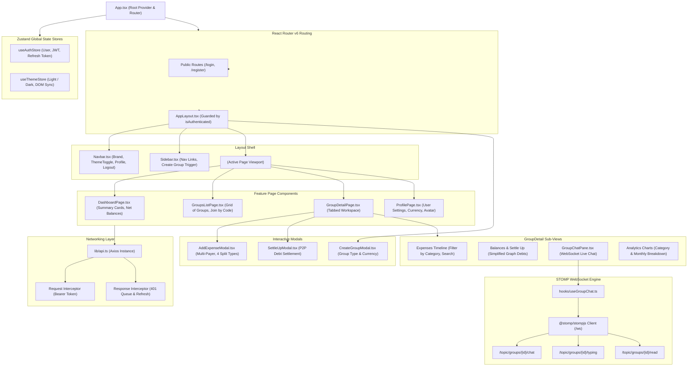
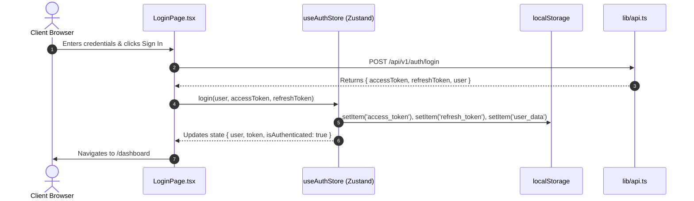
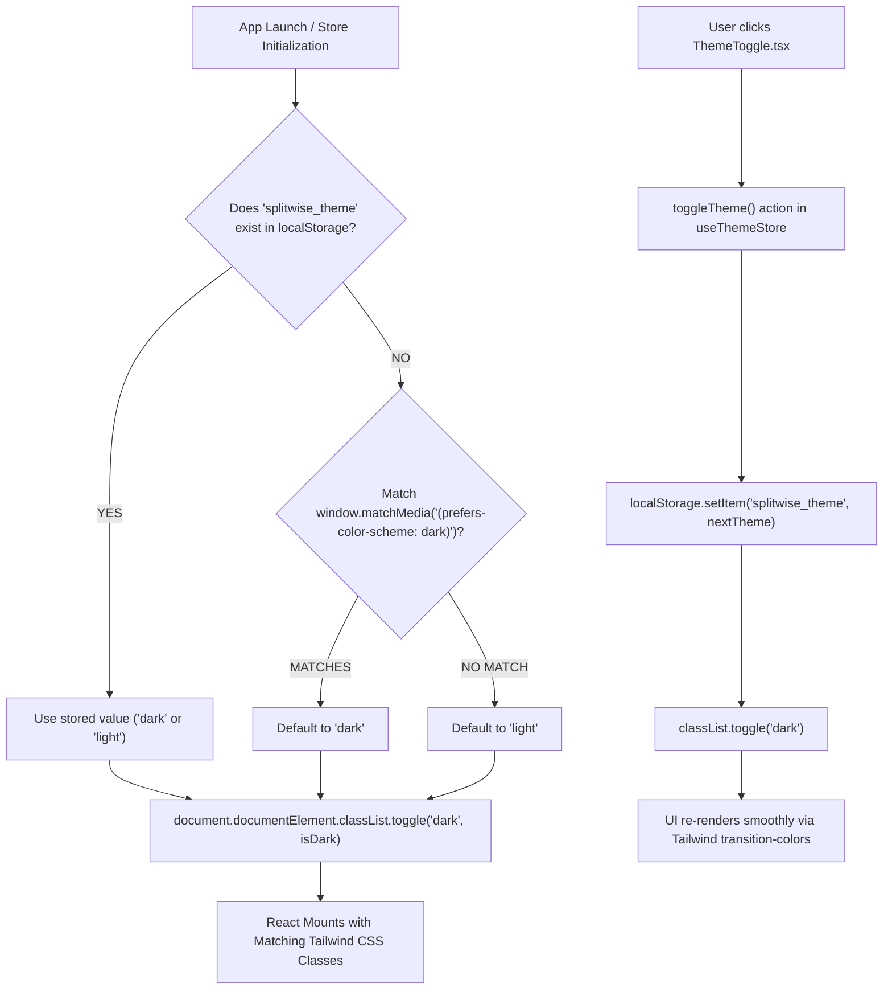
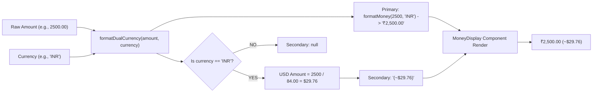
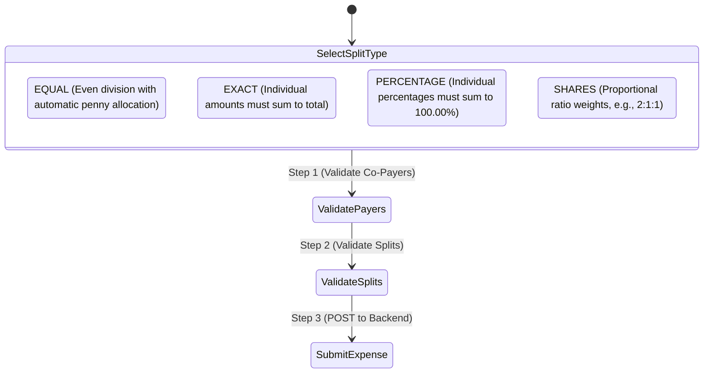
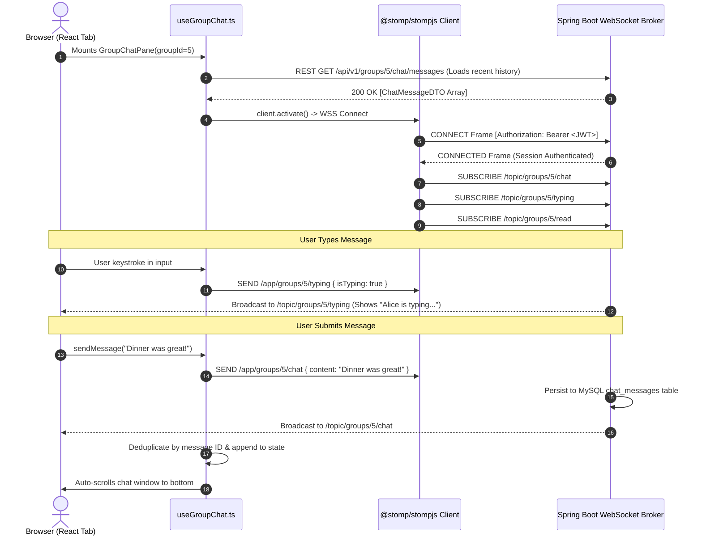
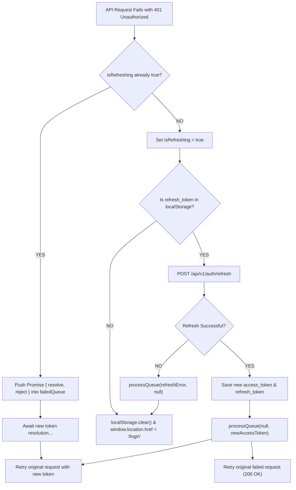

# Splitwise Frontend — Complete Technical Interview Master Guide

> **Purpose of this Document**:  
> This guide breaks down the entire Splitwise frontend codebase component-by-component, hook-by-hook, and state-by-state. It includes **visual block diagrams for every phase**, **state management flowcharts**, **real-time WebSocket STOMP pipelines**, and **verbatim model answers to explain in technical frontend interviews**.

---

## Table of Contents
1. [The 30-Second Elevator Pitch (Start Your Interview Here)](#1-the-30-second-elevator-pitch)
2. [Complete Frontend Architecture & Component Hierarchy](#2-complete-frontend-architecture--component-hierarchy)
3. [Frontend Directory & Package Structure](#3-frontend-directory--package-structure)
4. [Phase 1: State Management (Zustand over Redux)](#4-phase-1-state-management-zustand-over-redux)
5. [Phase 2: Theme Engine (Dark & Light Mode Architecture)](#5-phase-2-theme-engine-dark--light-mode-architecture)
6. [Phase 3: Dual-Currency Engine & Financial UI](#6-phase-3-dual-currency-engine--financial-ui)
7. [Phase 4: Multi-Strategy Expense Engine (`AddExpenseModal.tsx`)](#7-phase-4-multi-strategy-expense-engine-addexpensemodaltsx)
8. [Phase 5: Real-Time Communication & WebSockets (`useGroupChat.ts`)](#8-phase-5-real-time-communication--websockets-usegroupchatts)
9. [Phase 6: Networking, Security & Axios Interceptors (`lib/api.ts`)](#9-phase-6-networking-security--axios-interceptors-libapits)
10. [Top 12 Tricky Frontend Interview Questions & Verbatim Model Answers](#10-top-12-tricky-frontend-interview-questions--verbatim-model-answers)

---

## 1. The 30-Second Elevator Pitch

When the interviewer asks: **"Tell me about the frontend of this project and your technical choices"**, say this:

> *"I engineered the Splitwise frontend using **React 18**, **TypeScript**, **Tailwind CSS**, and **Vite** with a focus on high-performance financial rendering and real-time collaboration.*  
> *The frontend solves four critical UI/UX challenges:*  
> 1. *A **Dual-Currency Reactive Engine**: When Indian Rupee (INR) is selected, expenses automatically compute and render real-time US Dollar equivalents ($\sim\$X.XX$) alongside ₹ amounts with zero layout shifts.*  
> 2. *A **Resilient Dark/Light Theme System**: Built with Tailwind CSS and Zustand, persisting user preference to `localStorage` and synchronizing with the browser DOM before render to eliminate Flash of Unstyled Content (FOUC).*  
> 3. *An **Event-Driven STOMP WebSocket Client**: Engineered a custom `useGroupChat` hook managing 3 distinct real-time streams (chat messages, debounced typing indicators, and read receipts) with automatic 5-second reconnect backoff and message deduplication.*  
> 4. *A **Zero-Race-Condition Axios Interceptor**: Implements an asynchronous request queue that pauses concurrent failed API requests while refreshing expired JWT tokens, seamlessly retrying them once the new token is minted."*

---

## 2. Complete Frontend Architecture & Component Hierarchy

### Component Hierarchy Block Diagram



---

## 3. Frontend Directory & Package Structure

```
frontend/src/
├── main.tsx                    # ReactDOM root render
├── App.tsx                     # Top-level React Router configuration & auth bootstrap
├── vite-env.d.ts               # Vite TypeScript environment declarations
├── index.css                   # Tailwind directives & CSS custom properties
│
├── lib/
│   └── api.ts                  # Axios client with request queue & 401 auto-refresh
│
├── store/                      # Zustand global state stores
│   ├── authStore.ts            # User profile, tokens, login/logout actions
│   └── themeStore.ts           # Dark/light mode state & DOM class synchronization
│
├── types/
│   └── index.ts                # TypeScript domain interfaces (User, Group, Expense, etc.)
│
├── utils/
│   └── currencyUtils.ts        # Currency formatting, USD-to-INR conversion, dual display
│
├── hooks/
│   └── useGroupChat.ts         # STOMP WebSocket hook (messages, typing, read receipts)
│
├── components/
│   ├── ui/                     # Reusable design system primitives
│   │   ├── Avatar.tsx          # Dynamic user avatar with fallback initials
│   │   ├── Button.tsx          # Styled buttons with loading spinners & variants
│   │   ├── Input.tsx           # Standardized inputs with field placeholders
│   │   ├── Modal.tsx           # Accessible dialog backdrop with ESC & click-outside
│   │   ├── MoneyDisplay.tsx    # Dual-currency renderer (₹ + ~$ USD)
│   │   └── ThemeToggle.tsx     # Animated Sun/Moon dark mode toggle button
│   │
│   ├── layout/                 # Application frame
│   │   ├── AppLayout.tsx       # Protected layout boundary with Navbar & Sidebar
│   │   ├── Navbar.tsx          # Header with user profile, theme toggle, and logout
│   │   └── Sidebar.tsx         # Left navigation bar with active route highlight
│   │
│   ├── expenses/               # Expense management
│   │   └── AddExpenseModal.tsx # Multi-payer allocation & 4-strategy split builder
│   │
│   ├── settlements/            # Debt settlement
│   │   └── SettleUpModal.tsx   # Record payments with dual-currency conversion
│   │
│   └── chat/                   # Real-time collaboration
│       └── GroupChatPane.tsx   # Chat UI, attachment previews, typing indicator
│
└── pages/                      # Routed views
    ├── auth/
    │   ├── LoginPage.tsx       # Sign in with email & password
    │   └── RegisterPage.tsx    # Sign up with phone prefix & default currency
    ├── dashboard/
    │   └── DashboardPage.tsx   # Aggregated net balances & activity overview
    ├── groups/
    │   ├── GroupsListPage.tsx  # Cards view of groups & join-by-invite-code
    │   ├── GroupDetailPage.tsx # Tabbed group workspace (Expenses, Balances, Chat)
    │   └── CreateGroupModal.tsx# Form to create Trip, Home, Couple, or Other group
    └── profile/
        └── ProfilePage.tsx     # View & edit personal details and currency
```

---

## 4. Phase 1: State Management (Zustand over Redux)

### Why Zustand?
In modern frontend engineering, Redux is often overkill for client state:
- **Zero Boilerplate**: No actions, action creators, reducers, or dispatch wrappers.
- **Granular Selectors**: Components subscribe only to the specific slices of state they need (`useAuthStore((s) => s.user)`), preventing entire page re-renders.
- **Tiny Bundle Footprint**: Zustand is **~1.1 KB minified**, compared to **>50 KB** for Redux Toolkit + React-Redux.
- **Outside-React Access**: Zustand stores can be read and written directly in non-React files like Axios interceptors (`useAuthStore.getState().logout()`).

### Authentication State Flowchart



### Store Implementation Highlights (`store/authStore.ts`)
- **Hydration on Startup**: Reads initial state directly from `localStorage` so a page refresh never logs the user out.
- **Atomic Logout**: Removes tokens and resets user state in a single synchronistic call.
- **User Sync**: `fetchCurrentUser()` updates the store if backend user attributes change (e.g., currency, avatar).

---

## 5. Phase 2: Theme Engine (Dark & Light Mode Architecture)

### How It Works: Zero-Flash Dark Mode
Most naïve dark mode implementations suffer from **Flash of Unstyled Content (FOUC)**, where a bright white screen flashes before JavaScript evaluates user preference.

We solved this via a three-tiered resolution hierarchy:
1. **Local Storage First**: If the user has manually toggled a theme (`splitwise_theme`), use it.
2. **OS System Preference Second**: Fall back to `window.matchMedia('(prefers-color-scheme: dark)').matches`.
3. **Immediate DOM Mutation**: Before React finishes mounting, `document.documentElement.classList.add('dark')` is applied directly.

### Theme Switching Flowchart



### Tailwind Configuration
In `tailwind.config.js`:
```js
module.exports = {
  darkMode: 'class', // Controlled explicitly via the 'dark' class on <html>
  theme: {
    extend: {
      colors: {
        brand: { 500: '#10B981', 600: '#059669', ... } // Emerald green Splitwise palette
      }
    }
  }
}
```

---

## 6. Phase 3: Dual-Currency Engine & Financial UI

### The Problem
Users in India frequently split expenses denominated in Indian Rupees (₹), but international roommates, travelers, or overseas clients need to know the equivalent cost in US Dollars ($).

### The Solution: `MoneyDisplay.tsx` & `currencyUtils.ts`



### Standardized Form Placeholders & Input UX
Per user requirements, generic dummy names in input fields were replaced with clean, domain-specific field identifiers:
- Username: `placeholder="username"`
- Email: `placeholder="username@domain.com"`
- Password: `placeholder="password"`
- Group Name: `placeholder="group_name"`
- Expense Title: `placeholder="expense_title"`
- Phone Number: Automatically initializes with **`+91 `** when Indian Rupee (INR) is selected, or **`+1 `** when USD is selected.

---

## 7. Phase 4: Multi-Strategy Expense Engine (`AddExpenseModal.tsx`)

### The 4 Splitting User Experiences



### Multi-Payer Co-Funding Architecture
In real-world group trips, bills are frequently co-funded (e.g., Alice paid \$70 and Bob paid \$30 on a \$100 grocery run).
Our modal supports multi-payer co-funding:
1. `payerAmounts` is stored as `Record<number, string>` (mapping `userId` to dollar string).
2. The UI continuously sums all payer inputs:
   $$\sum \text{payerAmounts} == \text{totalAmount}$$
3. If the sum deviates by more than $\$0.01$, the form presents a clear inline warning and disables submission, preventing server-side 400 Bad Request errors.

### Split Type Form Behaviors:
| Split Type | User Inputs | Client-Side Pre-Validation |
|---|---|---|
| **EQUAL** | Checkbox per participant (include/exclude) | At least 1 member must be selected. |
| **EXACT** | Dollar input per participant | $\sum \text{exactValues} == \text{totalAmount} \pm \$0.01$. |
| **PERCENTAGE** | Percentage input per participant | $\sum \text{percentages} == 100.0\% \pm 0.05\%$. |
| **SHARES** | Integer share weights (e.g., 1, 2, 3) | All share values must be positive integers $> 0$. |

---

## 8. Phase 5: Real-Time Communication & WebSockets (`useGroupChat.ts`)

### Why STOMP over Raw WebSockets?
Raw WebSockets provide a bare byte/text stream without routing semantics. **STOMP (Simple Text Oriented Messaging Protocol)** introduces pub/sub framing, message headers, destinations, and acknowledgments—mirroring HTTP principles over a persistent TCP socket.

### Real-Time Flow Architecture



### Key Technical Details in `useGroupChat.ts`:
1. **Message Deduplication**:
   When receiving messages over WebSocket that may also have been fetched during REST history hydration, messages are reconciled by primary key:
   ```ts
   setMessages((prev) => {
     if (prev.some((m) => m.id === newMsg.id)) {
       return prev.map((m) => (m.id === newMsg.id ? newMsg : m));
     }
     return [...prev, newMsg];
   });
   ```
2. **Ephemeral Typing Presence**:
   Typing indicators use a `Map<number, string>` (mapping `userId` to `userName`). When `isTyping: false` is received, the user is deleted from the map.
3. **Double Blue Checkmark Read Receipts**:
   When a user views an unread message sent by someone else, the hook emits a read receipt event to `/app/groups/{groupId}/read`. The backend records it and broadcasts to `/topic/groups/{groupId}/read`, dynamically appending the viewer's `userId` to `message.readByUserIds`.

---

## 9. Phase 6: Networking, Security & Axios Interceptors (`lib/api.ts`)

### The 401 Refresh Race Condition Problem
When a user has an active dashboard with multiple widgets (Expenses list, Balances card, Analytics graph, User profile), all 4 requests fire simultaneously.
If the 15-minute access token has expired:
- **Without an interceptor queue**: All 4 requests receive HTTP 401 simultaneously and trigger 4 separate `/auth/refresh` calls. Because refresh tokens are rotated on each call, calls 2, 3, and 4 will fail with an invalidated refresh token, unexpectedly logging the user out!
- **With our Request Queue**: The first failed request locks `isRefreshing = true` and performs the refresh. Requests 2, 3, and 4 are enqueued as unresolved Promises in `failedQueue`. Once the new access token arrives, `processQueue()` resolves all queued requests and retries them with the new token.

### Request Interceptor Queue Flowchart



---

## 10. Top 12 Tricky Frontend Interview Questions & Verbatim Model Answers

### Q1: Why did you choose Zustand instead of Redux Toolkit or React Context?
> **Answer**:  
> *"React Context is not designed for high-frequency state updates; whenever any value in the Context object changes, every consuming component re-renders regardless of whether it uses that specific property, causing render thrashing. Redux Toolkit solves this but introduces heavy boilerplate with slices, dispatchers, and action creators, adding over 50 KB to the bundle.*  
> *Zustand provides the best of both worlds: a tiny 1.1 KB footprint, zero boilerplate, and selector-based subscriptions (`useAuthStore(s => s.user)`) that ensure components only re-render when their selected slice changes. Furthermore, Zustand allows accessing state outside the React component lifecycle, which was essential for attaching and refreshing tokens inside our Axios interceptors."*

---

### Q2: How does your Axios interceptor prevent the "Thundering Herd" problem when access tokens expire?
> **Answer**:  
> *"When multiple API requests trigger HTTP 401 concurrently, firing multiple refresh token requests will invalidate the session because our backend rotates refresh tokens on every call.*  
> *To solve this, our Axios response interceptor uses a mutex flag `isRefreshing` and a `failedQueue` array. The first 401 request sets `isRefreshing = true` and initiates a single `POST /api/v1/auth/refresh`. Subsequent 401 requests return a pending Promise that is stored in `failedQueue`. Once the refresh request succeeds, `processQueue()` iterates through the pending requests, updates their `Authorization` header with the new access token, and executes them seamlessly. The user never sees an error or session interruption."*

---

### Q3: How do you eliminate Flash of Unstyled Content (FOUC) in Dark Mode?
> **Answer**:  
> *"FOUC occurs when theme evaluation happens inside a `useEffect` hook after the browser has already painted the initial white HTML DOM.*  
> *We eliminated this by evaluating theme preference during the initial synchronous store initialization before React completes its render tree. The store checks `localStorage.getItem('splitwise_theme')` first, then falls back to `window.matchMedia('(prefers-color-scheme: dark)').matches`. It immediately adds or removes the `dark` class on `document.documentElement`. As a result, the browser applies dark Tailwind styles on the very first frame."*

---

### Q4: How do you prevent memory leaks and duplicate WebSocket subscriptions in React 18?
> **Answer**:  
> *"In React 18 Strict Mode, components mount, unmount, and remount immediately to verify effect cleanup. If subscriptions aren't tracked, duplicate listeners get created, causing duplicate message bubbles and ghost typing indicators.*  
> *In our custom `useGroupChat` hook, we store active subscriptions in a mutable ref (`subscriptionsRef = useRef<StompSubscription[]>([])`). On `onConnect`, we explicitly iterate over any existing subscriptions and call `.unsubscribe()`. In the hook's `useEffect` cleanup function, we unsubscribe from all topics and call `client.deactivate()`. This guarantees zero orphan connections or memory leaks."*

---

### Q5: How do you handle floating-point precision issues with currency in JavaScript?
> **Answer**:  
> *"JavaScript numbers are 64-bit binary floating-point IEEE 754 values, which means operations like `0.1 + 0.2` equal `0.30000000000000004`. In financial user interfaces, this causes rounding artifacts and validation failures.*  
> *On the frontend, we handle all user monetary inputs as strings, parsing them with explicit tolerances (e.g., `Math.abs(sum - total) < 0.01`). For currency display, we format numbers using `Intl.NumberFormat` / `toLocaleString('en-US', { minimumFractionDigits: 2, maximumFractionDigits: 2 })`. All authoritative financial balancing and penny distribution calculations are delegated to the Java backend using `BigDecimal` with Banker's rounding (`HALF_EVEN`)."*

---

### Q6: How do typing indicators work over WebSockets without flooding the network?
> **Answer**:  
> *"If an event were dispatched on every keystroke, a fast typist would emit dozens of WebSocket packets per second. In `useGroupChat.ts`, typing events are throttled:*  
> *When the user types, an initial `{ isTyping: true }` event is published to `/app/groups/{groupId}/typing`. We start a 3-second `setTimeout`. If the user continues typing, the timer resets. If no keystroke occurs for 3 seconds, or if the message is sent, we dispatch `{ isTyping: false }` and clear the timer. On the receiving end, incoming typing events populate a `Map<userId, userName>` state, ensuring the UI cleanly displays 'Alice and Bob are typing...'."*

---

### Q7: How does your dual-currency system work under the hood?
> **Answer**:  
> *"Our `currencyUtils.ts` module exports a standardized `formatDualCurrency(amount, currency)` function. When the active group or user currency is `INR`, it formats the primary amount in Indian Rupees (`₹X,XXX.XX`) and calculates the US Dollar equivalent using the exchange rate `inrToUsd(amount) = amount / 84.0`.*  
> *The `MoneyDisplay` component renders the primary amount and conditionally renders an adjacent `(~$Y.YY)` tag styled with reduced opacity and smaller font size. This ensures users immediately understand both the local and global cost without navigating away or manually converting currency."*

---

### Q8: How did you implement client-side validation for multi-payer expenses?
> **Answer**:  
> *"In `AddExpenseModal.tsx`, we maintain a `payerAmounts: Record<number, string>` dictionary mapping member IDs to their contributed amounts. As the user edits inputs, a derived calculation sums the parsed amounts.*  
> *Before submitting, the form validates that:*  
> *1. At least one payer has contributed $> \$0.00$.*  
> *2. The sum of all contributions matches `totalAmount` within a $\pm \$0.01$ margin.*  
> *If invalid, an inline warning displays the exact discrepancy (e.g., 'Sum of payers ($80.00) must equal total amount ($100.00)'), guiding the user to fix the mistake before an API call is made."*

---

### Q9: Why use Tailwind CSS with the `class` strategy instead of CSS-in-JS (like styled-components)?
> **Answer**:  
> *"CSS-in-JS libraries like Styled Components or Emotion add runtime overhead because they parse CSS rules, generate dynamic class names, and inject `<style>` tags into the DOM during React render cycles. This causes performance degradation, especially in large animated dashboards.*  
> *Tailwind CSS is an ahead-of-time utility compiler that generates a static CSS bundle containing only the classes actually used in the project. With the `darkMode: 'class'` strategy, toggling dark mode is an $O(1)$ class toggle on the `<html>` root, allowing GPU-accelerated styling transitions without runtime CSS evaluation."*

---

### Q10: How do you structure Protected Routes in React Router v6?
> **Answer**:  
> *"We use React Router v6 layout route architecture. In `App.tsx`, protected routes are wrapped inside `<Route element={<AppLayout />}>`.*  
> *Inside `AppLayout.tsx`, we read `isAuthenticated` from `useAuthStore`. If false, it immediately renders `<Navigate to="/login" replace />`, preventing unauthorized access. If true, it renders the common `Navbar`, `Sidebar`, and `<Outlet />`, which hosts the active matched child route (`DashboardPage`, `GroupDetailPage`, etc.)."*

---

### Q11: How do you prevent re-render performance bottlenecks in long expense timelines?
> **Answer**:  
> *"We use four optimization techniques:*  
> *1. **Memoized Filtering**: Search queries and category filters use `useMemo(() => expenses.filter(...), [expenses, searchTerm, categoryFilter])` so the list is only recomputed when dependencies change.*  
> *2. **Stable Component Callbacks**: Event handlers passed down to child rows are wrapped in `useCallback`.*  
> *3. **Unique Keys**: List items use stable database IDs (`key={expense.id}`) rather than array indices, allowing React's reconciliation engine to reuse DOM nodes during deletions and reordering.*  
> *4. **Isolated Modal State**: Complex form inputs for adding expenses and settlements live in isolated modal components (`AddExpenseModal`, `SettleUpModal`), ensuring keystrokes in the modal never re-render the underlying dashboard."*

---

### Q12: How do read receipts work in the chat interface?
> **Answer**:  
> *"Each message entity contains a `readByUserIds: number[]` array.*  
> *When a new message arrives, `GroupChatPane.tsx` checks if the sender is someone other than the current user and whether `readByUserIds` contains `currentUser.id`. If not, it emits a STOMP event to `/app/groups/{groupId}/read` with `{ messageId }`.*  
> *When the server broadcasts the receipt to `/topic/groups/{groupId}/read`, the hook updates state by appending the reader's user ID. The message bubble renders a `CheckCheck` icon colored slate-400 for sent messages, turning into vibrant emerald/brand-500 once other members have read the message."*

