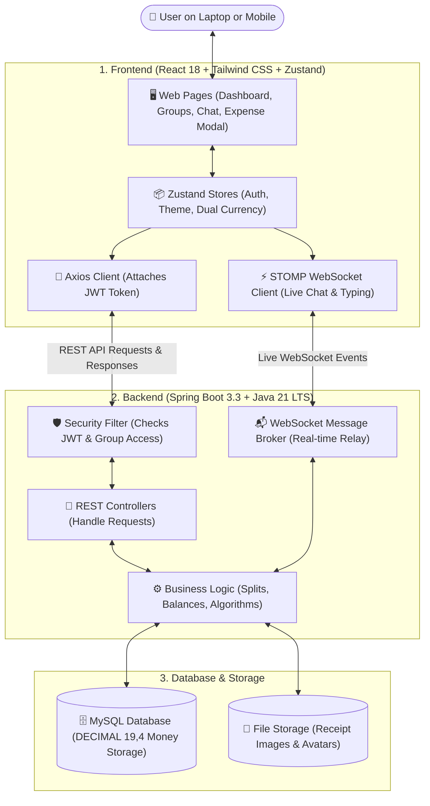
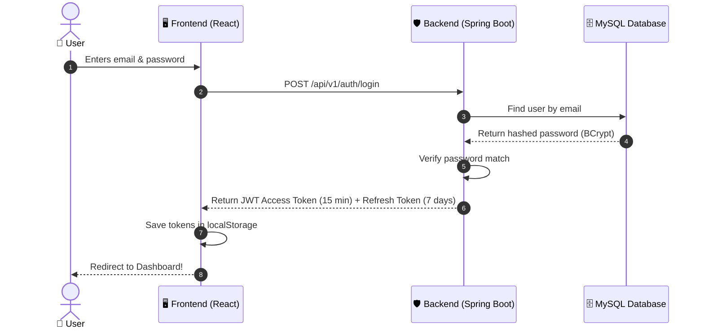
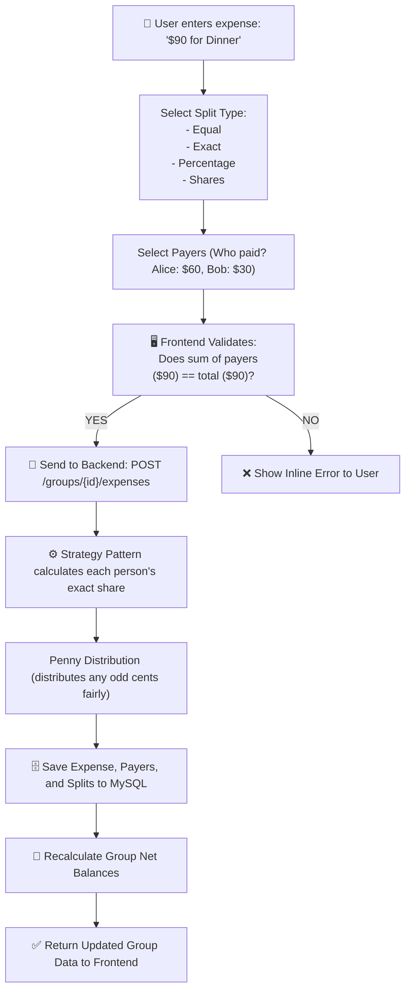
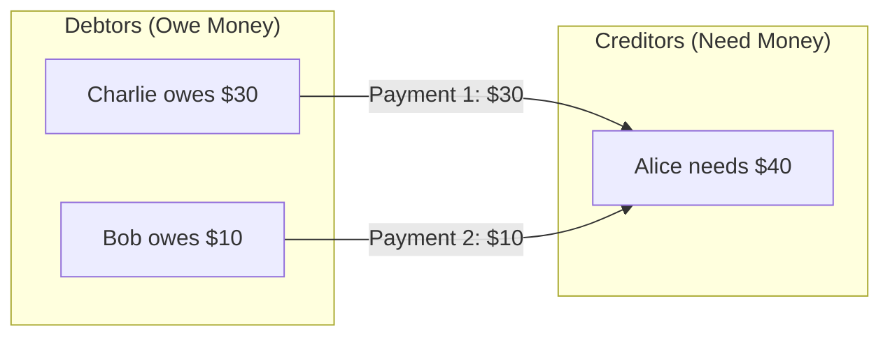
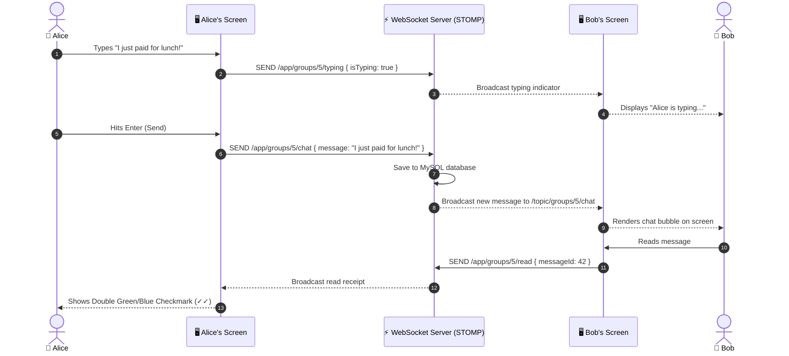
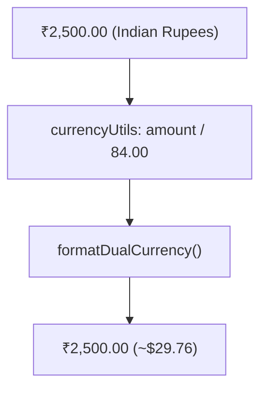

# Splitwise Clone — Simple Project Overview & Block Diagrams

> **What is this guide?**  
> This guide explains the entire Splitwise project in **simple, plain English** using **clean and easy-to-understand block diagrams**.  
> If you need to explain this project to an interviewer, recruiter, or colleague without getting lost in complicated jargon, this is your reference.

---

## 1. What Does This Project Do? (The Big Idea)

Imagine 3 friends—**Alice, Bob, and Charlie**—go on a weekend road trip:
- Alice pays **\$120** for petrol.
- Bob pays **\$90** for groceries.
- Charlie pays **\$60** for snacks.

At the end of the trip, who owes what to whom?
Without an app, calculating this gets messy with multiple transfers back and forth.

**Our Splitwise Application solves this completely:**
1. **Tracks Expenses**: Members log who paid and who participated.
2. **Splits Fairly**: Evenly, by exact amounts, percentages, or shares (down to the exact penny, with zero lost cents).
3. **Simplifies Debts**: Turns a confusing web of 10 different debts into **just 2 or 3 simple payments**.
4. **Instant Chat**: Members talk inside the group with live typing indicators and read receipts.
5. **Dual Currency**: Shows prices in Indian Rupees (**₹**) and automatic US Dollars (**\$**).
6. **Dark & Light Mode**: Seamless theme switching with zero page flash.

---

## 2. High-Level Architecture (The Big Picture)

Here is how the entire system connects from the user's screen down to the database:

### Simple Explanation of the 3 Layers:
1. **Frontend (Browser)**: The visual user interface built with React. It handles user clicks, displays numbers in ₹ and \$, and updates the screen instantly.
2. **Backend (Server)**: The brain built with Spring Boot and Java 21. It verifies passwords, calculates splits with financial accuracy, simplifies debts, and protects private data.
3. **Database (MySQL)**: The memory. It safely stores users, groups, expenses, and chat messages. Money is stored in `DECIMAL(19,4)` so no floating-point rounding errors ever occur.

---

## 3. How User Authentication Works (Sign In & Security)

### In Plain Words:
- You type your email and password.
- The server checks if your password matches the encrypted hash in the database.
- The server hands back a **digital VIP badge (JWT Token)**.
- Every time you click something, your browser shows this badge so the server knows who you are.

---

## 4. How Adding an Expense Works (Step-by-Step)

Here is what happens when someone clicks **"Add Expense"**:

### The Penny Distribution Trick (Explained Simply):
What happens if 3 roommates split a **\$100.00** grocery bill equally?
- In basic math: $100 \div 3 = 33.333333...$
- If everyone pays \$33.33: $33.33 \times 3 = \$99.99$. **Where did the 1 cent go?**
- **Our Solution**:
  - Person 1 pays: **\$33.34**
  - Person 2 pays: **\$33.33**
  - Person 3 pays: **\$33.33**
  - $\text{Total} = \mathbf{\$100.00}$ exactly! Not a single cent is ever lost.

---

## 5. How Debt Simplification Works (The Min-Cash-Flow Algorithm)

This is the most impressive algorithm in Splitwise. Here is how it turns messy debts into minimal payments:

### Before Simplification (Messy Web of Debts):
Without simplification, 3 people might have 3 separate debts:
- Alice owes Bob **\$20**
- Bob owes Charlie **\$20**
- Charlie owes Alice **\$10**

### The Concept: Calculate Net Balance First
Instead of looking at pairwise IOUs, the system calculates everyone's **Net Balance**:
$$\text{Net Balance} = \text{Total Paid} - \text{Total Owed}$$

| Person | Total Paid | Total Owed | Net Balance | Role |
|---|---|---|---|---|
| **Alice** | \$60 | \$20 | **+\$40** | **Creditor** (should receive \$40) |
| **Bob** | \$20 | \$30 | **-\$10** | **Debtor** (owes \$10) |
| **Charlie** | \$10 | \$40 | **-\$30** | **Debtor** (owes \$30) |

Notice: $+40 + (-10) + (-30) = 0$. Money is always conserved!

### The Algorithm (Greedy Max-Heap Flow):

### Result:
- **Transaction 1**: Charlie pays Alice **\$30**. (Charlie is done!). Alice now only needs \$10.
- **Transaction 2**: Bob pays Alice **\$10**. (Bob is done! Alice has received all \$40!).
- **Everyone is settled with only 2 transactions instead of a confusing web!**

---

## 6. How Real-Time Group Chat Works

When friends are inside a group, they can chat, see who is typing, and see who read their messages in real time.

---

## 7. Dual Currency Engine (₹ INR & $ USD)

Whenever an Indian Rupee (INR) amount is displayed, the app automatically calculates and shows the US Dollar ($) equivalent right beside it:

- **Seamless**: Converted dynamically without layout shifting.
- **Phone Prefix**: Selecting INR automatically adds **`+91 `** to the phone number input; selecting USD sets **`+1 `**.
- **Field Placeholders**: Placeholders use clean field identifiers (`username`, `group_name`, `expense_title`, `password`) instead of hardcoded sample names.

---

## 8. Technology Stack Summary (Simple Table)

| Layer | Technology | Why We Used It (In 1 Sentence) |
|---|---|---|
| **Frontend UI** | **React 18 + TypeScript** | Type-safe, component-driven UI that renders quickly without errors. |
| **Styling** | **Tailwind CSS** | Clean modern utility styles with instant Dark and Light mode support. |
| **State Management** | **Zustand** | Ultra-lightweight (1.1 KB) store with zero boilerplate and no re-render lag. |
| **Backend API** | **Java 21 + Spring Boot 3.3** | High-performance enterprise platform with rock-solid stability. |
| **Security** | **Spring Security 6 + JWT** | Protects endpoints and ensures users can only see their own groups (Anti-IDOR). |
| **Real-Time** | **STOMP over WebSocket** | Delivers instant chat messages, typing events, and read receipts. |
| **Database** | **MySQL 8.0** | Reliable ACID database using `DECIMAL(19,4)` so balances are never lost. |
| **Design Patterns** | **Strategy Pattern** | Allows adding new split types (Equal, Exact, %, Shares) cleanly without rewriting code. |

---

## 9. Quick 5-Point Summary to Memorize for Interviews

1. **Architecture**: It is a full-stack **Modular Monolith** using **React 18** on the frontend and **Spring Boot 3.3 (Java 21)** on the backend.
2. **Financial Precision**: Money is never stored as `float` or `double`. We use Java's **`BigDecimal`** and MySQL's **`DECIMAL(19,4)`** with odd-penny distribution to prevent any monetary rounding errors.
3. **Debt Simplification**: We use a **Greedy Dual Max-Heap Min-Cash-Flow algorithm** that takes $O(N^2)$ complex pairwise debts and reduces them to at most $N-1$ simple payments.
4. **Real-Time Features**: Group chat, typing presence, and read receipts run on **WebSocket + STOMP** protected by custom Spring Security interceptors.
5. **Modern UX**: Features instant **Dark/Light mode**, **Dual Currency (₹ INR + \$ USD)**, and safe **Axios 401 token refresh queuing**.

